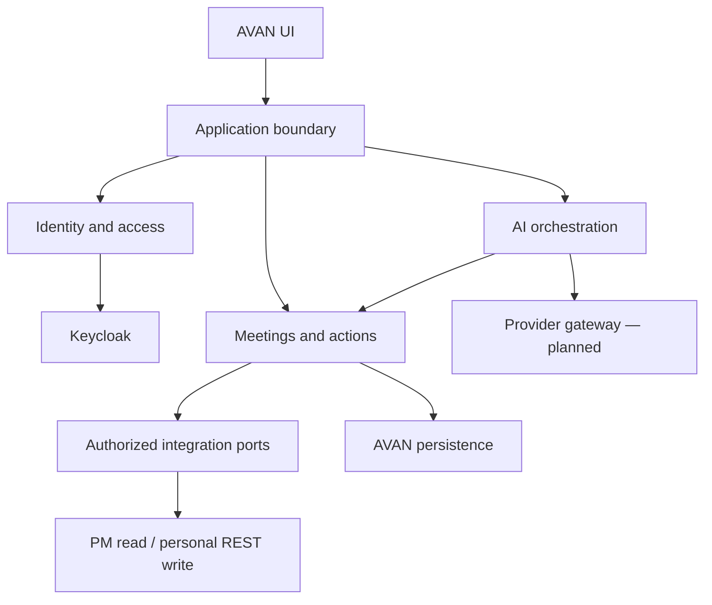

# AVAN architecture baseline and incremental migration

Baseline `4a0b583cf098268ba8c3784e22b87df10b0fc5f2`; 2026-10-04.
Evidence: repository inventory and selected implementation/configuration/test review.
This is not a line-by-line audit, production penetration test or proof of live health.
Module cards in `docs/ai/modules.json` are the maintained navigation source.

## 1. Current architecture

Python FastAPI modular application with large composition/route files:
`production_app.py`, `setup_routes.py`, `agent_routes.py`. Browser production/admin
JavaScript, Keycloak theme/provider, internal anti-bot service, SQL Server owned
state, external ProcessMaker MySQL/REST, PostgreSQL for Keycloak, Docker/Caddy.
This is already closer to a modular monolith than independent business microservices.

## 2. Authentication

`production_app.py` owns OIDC redirects/callback/session handling and internal
security bridge; `security.py` identity primitives; Keycloak owns organizational
password/conditional OTP. Theme/provider under `infra/keycloak` fetch CAPTCHA
challenge from AVAN, which calls anti-bot. Local GodAdmin lives in
`local_godadmin.py` and setup routes. Public organization entry is `/auth/login`;
`/admin/` is installation/recovery. Discovery, form rendering, challenge readiness,
credential success and OTP completion are distinct observable checks.

## 3. Authorization

`native_access.py`, `authorization_v2.py`, `directory_access.py` and route checks
handle AVAN permissions. Keep subject, tenant, source and task ownership explicit.
The existence of role functions does not prove every route applies them correctly.
Add cross-tenant negative integration cases before migrating a route.

## 4. Account lifecycle

`user_accounts.py`, `identity_operator.py`, `pending_identities.py` and setup routes
coordinate local records and Keycloak provisioning. Existing focused tests cover
managed creation/recovery. Target: durable provisioning operation with idempotency,
compensation and reconciliation across partial IdP/database failures. Permanent
initial credentials unless policy explicitly requires rotation; do not imply all
partial-failure paths are already durable.

## 5. Owned data

`agent_storage.py` exposes SQL transactions and encrypted aggregate state; other
stores and SQL scripts coexist. Move domain records incrementally to relational,
tenant-scoped schemas with migrations, unique constraints and audit events.
Do not silently rewrite existing encrypted blobs or rotate their encryption key.

## 6. BPMS integration

`processmaker_store.py`/directory adapters read PM; `secretary_credentials.py`,
setup OAuth logic and secretary adapters manage REST credentials/actions.
`user_bpms_bindings.py` binds external source/account to AVAN subject explicitly.
Target ports: directory reader, task reader, personal workflow writer. MySQL stays
read-only. REST writes require personal OAuth, task authorization and idempotency.
Host URL alone does not establish workspace, OAuth client or process/task IDs.

## 7. AI runtime

`meeting_agent.py`, `agent_tools.py`, `agent_routes.py` combine model execution and
business tools. OpenAI-specific configuration and in-process concurrency state remain.
Target gateway normalizes provider request/result/usage; orchestration owns trace,
limits and approvals; tools enforce domain authorization independently of prompts.
Developer context tooling in this change does not reduce runtime model input by itself.

## 8. Technical debt

Large route and JS files increase context cost and change coupling. Multiple storage
styles and historical setup/login instructions require explicit ownership. Avoid
moving every file at once: extract one capability behind existing HTTP contracts,
then compare behavior with characterization tests. Manifest ownership may overlap
for shared files; reverse dependencies conservatively widen focused tests.

## 9. Security review backlog

Verify tenant scope at every read/write, uniqueness of external bindings under
concurrent requests, OAuth ownership, secret redaction, CSRF/callback host/state,
CAPTCHA replay/expiry, OTP session issuance and partial provisioning compensation.
These are review gates, not newly proven vulnerabilities. Preserve fail-closed
checks. Recovery must work while PM/AI are unavailable; verify without DB rather
than assuming the current SQL-backed architecture guarantees it.

## 10. Legacy and duplication

Lab/demo/preview entrypoints coexist with production. Keep quarantined and exclude
from production images; retain until call sites/packaging tests prove removal safe.
Generated Keycloak scene assets intentionally duplicate canonical admin assets:
use the sync script, not independent edits. Old handoff is archived, not discarded.
No unproven dead-code deletion belongs in this increment.

## 11. Target architecture decision

Choose a modular monolith first. Boundaries: Identity, Authorization/Organization,
Integration/BPMS, Meetings/Actions, AI Runtime/Gateway, Licensing, Administration,
Persistence. Modules expose application services/ports; domain code cannot depend
on FastAPI, external provider SDKs or SQL driver details. One composition root wires
adapters. Enforce boundaries during incremental extraction, not via naming alone.
A future .NET 10 core must preserve API/event contracts and data migration gates;
no second credential store or immediate language rewrite is justified.

Business packs: versioned process/task/role mapping plus validated capabilities;
plugin lifecycle, billing and SaaS isolation are planned capabilities, not completed
features. Never activate live role grants from inferred task names alone.

## 12. Migration and rollback

0. Stabilize auth and collect real rendering/challenge/OTP evidence.
1. Isolate identity/provisioning contracts with compensation tests.
2. Extract owned core records with versioned migrations and tenant constraints.
3. Extract BPMS adapters; retain read-only MySQL/personal REST separation.
4. Introduce provider-neutral AI gateway, usage/cost and trace/tool limits.
5. Extract meeting/action services and validate pack upgrades.
6. Add versioned business-pack lifecycle; 7. SaaS/licensing/billing; 8. hardening.

Each step keeps external routes compatible, migrates one aggregate/adapter, records
before/after tests and uses a feature switch where behavior changes. Roll back app
and additive migrations together according to migration compatibility; backups are
required before irreversible schema steps. Preserve Docker secrets and volumes.

## 13. Phase 0 backlog and acceptance

| Work | Acceptance | Status in this increment |
|---|---|---|
| Bounded module context | Valid paths/acyclic dependencies, overflow fails, unknown changes run all tests | Implemented |
| Compact handoff | Historical detail retained outside default context | Implemented |
| Runtime login render | Actual Keycloak HTTP 200, expected form, no server-error page | Existing CI gate |
| Security challenge | Actual bridge/anti-bot yields usable challenge | CI strengthened; live execution unverified |
| Login lifecycle | No-OTP and enrolled-OTP success; bad/expired OTP and challenge rejected | Live environment required |
| Recovery | Owner recovery with PM/AI unavailable, then database failure case | Live environment required |
| Fixed login card | Desktop/mobile and OTP screenshots, no drag/collapse | Browser acceptance required |
| Business roles | Explicit tenant/source/account/process/task mappings and positive/negative tests | Requires actual installation mapping |

Do not mark Phase 0 complete from mocked tests. No production credentials, secrets,
server logs or customer data belong in AI module cards.
